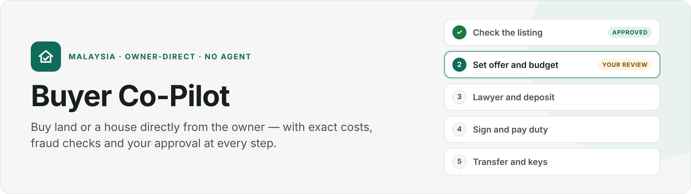
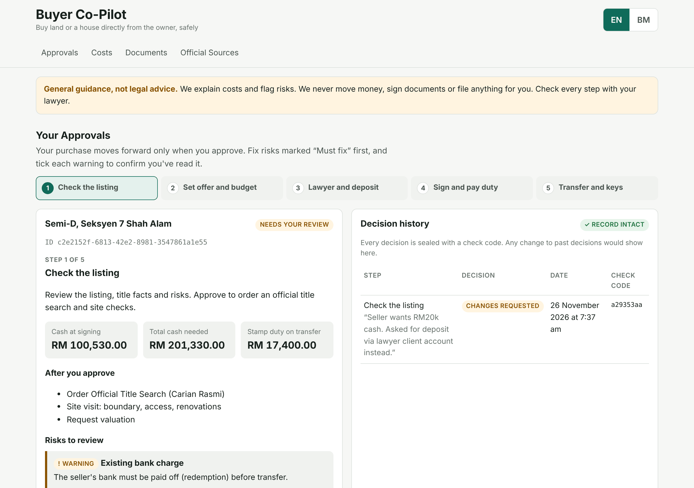
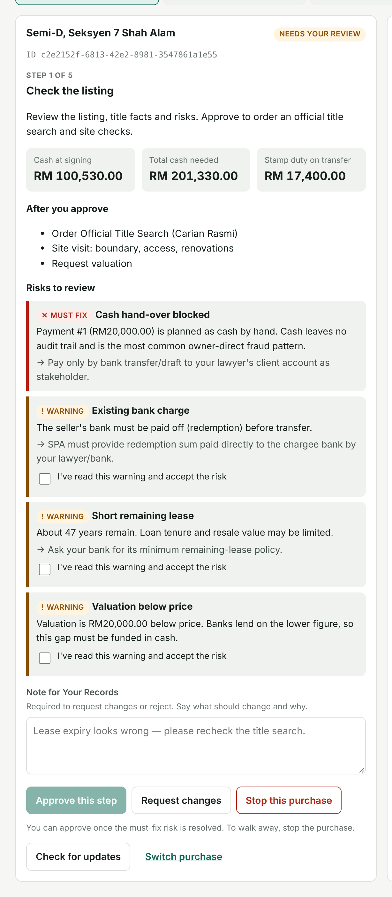
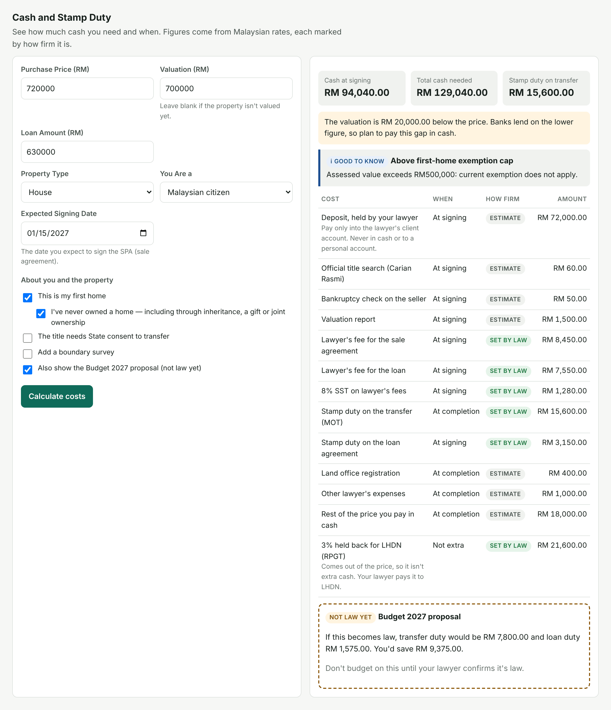
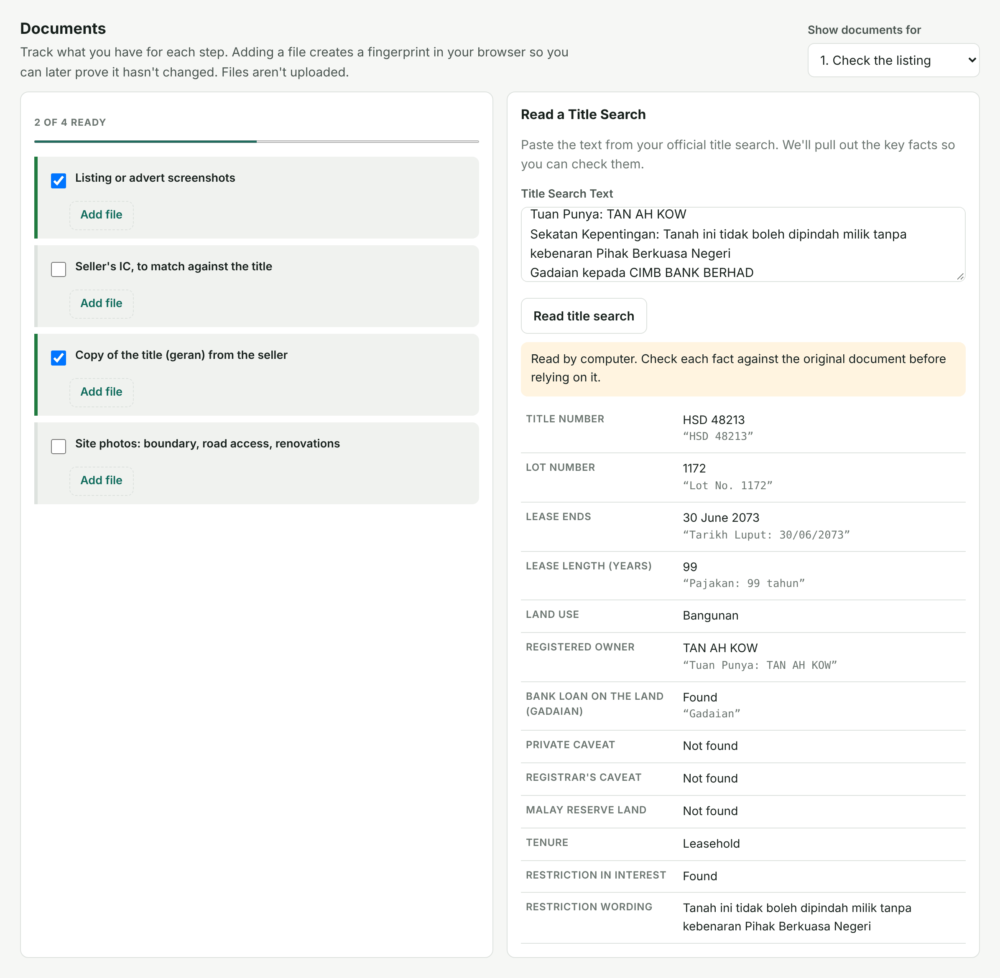
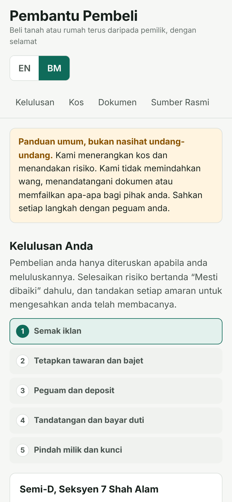
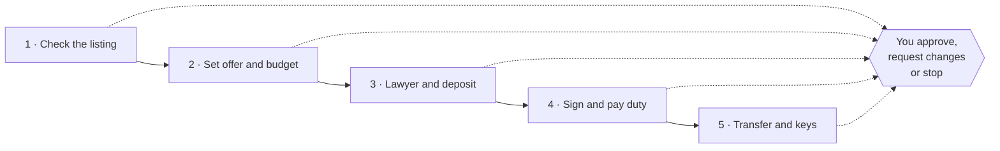

<div align="center">

<picture>
  <source media="(prefers-color-scheme: dark)" srcset="docs/assets/banner-dark.png">
  
</picture>

<br/>

[](https://github.com/kuganryde/buyer-copilot-my/actions/workflows/ci.yml)


**[What it does](#what-it-does)** · **[Screenshots](#see-it-in-action)** · **[Quick start](#quick-start)** · **[How it works](#how-it-works)** · **[Docs](#documentation)** · **[Security](#security)**

</div>

> [!IMPORTANT]
> **General guidance, not legal advice.** Buyer Co-Pilot explains costs and flags risks. It **never** moves money, signs documents or files anything with an authority. Confirm every step with a licensed conveyancing lawyer.

## Why this exists

Buying directly from an owner saves agent commission. It also removes the person who usually spots a fake seller, a bank charge on the title, a lease that's about to run out, or a "cash only" deposit.

Buyer Co-Pilot fills that gap **without taking any decision away from you**. It checks each stage of the purchase, shows exactly what you'll pay and when, and then **waits for your approval** before anything moves forward.

## What it does

<table>
<tr>
<td width="50%" valign="top">

### 🧮 Exact costs, clearly labelled
Transfer (MOT) and loan stamp duty, lawyer's fees under SRO 2023, SST, RPGT retention, valuation gap and cash needed at signing.
- Exact decimal maths in the engine, never in the browser
- Every figure marked **Set by law**, **Estimate** or **Proposal**
- First-home exemption built in; the Budget 2027 proposal is kept separate as **"Not law yet"**

</td>
<td width="50%" valign="top">

### 🛡️ Fraud and title checks
Risks are flagged in plain words, each with a next step:
- **Must fix:** cash hand-overs, a seller who isn't the registered owner, Registrar's caveats, Malay Reserve land, no road access, under-declared prices
- **Warning:** bank charges, private caveats, short leases, unapproved renovations

</td>
</tr>
<tr>
<td valign="top">

### ✅ Your approval at every step
Five steps run from **Check the listing** to **Transfer and keys**.
- Approve, request changes or stop at each one
- Approval stays locked while a must-fix risk is open, both in the app **and** in the database
- Every decision is sealed with a check code, so any tampering shows

</td>
<td valign="top">

### 📄 Documents and official sources
- Checklist for every step, with browser-side file fingerprints
- Paste an official title search to pull out owner, tenure, lease end, charges and restrictions
- Directory of government sources (LHDN, JPPH, PTG, Bar Council), filterable by topic and state

</td>
</tr>
</table>

## See it in action

<picture>
  <source media="(prefers-color-scheme: dark)" srcset="docs/screenshots/hero-dark.png">
  
</picture>

<table>
<tr>
<td width="50%" align="center"><b>Must-fix risks lock approval</b><br/><sub>A seller asks for RM20,000 in cash. Approval is blocked, and the page says why.</sub><br/><br/></td>
<td width="50%" align="center"><b>Exact costs and when you pay them</b><br/><sub>Each figure is marked by how firm it is. Budget 2027 is shown separately.</sub><br/><br/></td>
</tr>
<tr>
<td align="center"><b>Title search, read for you</b><br/><sub>Key facts pulled out, each with the original wording to check against.</sub><br/><br/></td>
<td align="center"><b>English and Bahasa Melayu, on any screen</b><br/><sub>Every label, status and error message is translated.</sub><br/><br/></td>
</tr>
</table>

## Quick start

**Prerequisites:** Python 3.11+ and Node 20.9+. PostgreSQL is optional; without it the engine uses an in-memory store.

```bash
git clone https://github.com/kuganryde/buyer-copilot-my.git && cd buyer-copilot-my

# 1 — Rule engine
cd engine
python3 -m venv .venv && . .venv/bin/activate
pip install -r requirements.txt && pip install -e ".[dev]"
pytest                                   # 83 pass; 4 database tests skip without PostgreSQL

export ENGINE_SERVICE_TOKEN=$(python3 -c "import secrets;print(secrets.token_urlsafe(48))")
export ENGINE_BUYER_PROXY_TOKEN=$(python3 -c "import secrets;print(secrets.token_urlsafe(48))")
export N8N_RESUME_TOKEN=$(python3 -c "import secrets;print(secrets.token_urlsafe(48))")
COPILOT_ENV=development uvicorn --factory copilot_engine.api:app_factory --port 8000 &

# 2 — Web hub (same terminal, so it inherits the token)
cd ../web && npm ci && npm run build
COPILOT_ENV=development COPILOT_DEMO_MODE=true ENGINE_URL=http://127.0.0.1:8000 npm start
```

Open **http://localhost:3100**. For the full stack, including PostgreSQL and n8n in Docker Compose, see the **[runbook](docs/RUNBOOK.md)**.

## How it works



Each step pauses until you decide. Behind the scenes, each layer enforces the rules independently:

| Layer | Role | Built with |
|---|---|---|
| **Web hub** | One page for approvals, costs, documents and sources. Holds no secrets and does no maths. | Next.js 16, React 19, TypeScript |
| **Rule engine** | Costs, risk checks, approval rules and the title-search reader | Python, FastAPI, `Decimal` |
| **Workflow** | Pauses for each approval, then re-checks the sealed record before continuing | n8n |
| **Database** | System of record. Triggers enforce the step rules; row-level security keeps each buyer private. | PostgreSQL 16, optional pgvector |

Diagrams and design principles are in **[docs/ARCHITECTURE.md](docs/ARCHITECTURE.md)**.

## Documentation

| Guide | What's inside |
|---|---|
| 📘 [Using the hub](docs/USING-THE-HUB.md) | The four sections and five approval steps, from a buyer's point of view |
| 🏗️ [Architecture](docs/ARCHITECTURE.md) | System, sequence and state diagrams; C4 detail; design principles |
| 🧮 [Cost rules](docs/COST-RULES.md) | Every rate and exemption, its legal status, and a worked example |
| 🔐 [Security model](docs/SECURITY-MODEL.md) | Threats and the controls that stop them |
| 🛠️ [Runbook](docs/RUNBOOK.md) | Local setup, database tests, Docker Compose, n8n wiring, changing a rule |
| 🚀 [CI/CD](docs/CI-CD.md) | Pipeline stages and recommended promotion path |
| ✍️ [Content guide](web/CONTENT_GUIDE.md) | Voice, wording patterns and fixed terminology (EN/BM) |
| ✅ [Verification](docs/VERIFICATION.md) | What's tested, recent fixes, and what isn't verified yet |

## Project structure

```
buyer-copilot-my/
├── engine/          Python rule engine, risk checks, approval rules, API and 87 tests
├── db/              PostgreSQL schema (triggers, row-level security, roles) and directory seed data
├── n8n/             Workflow that pauses for human approval
├── web/             One-page Buyer Command Hub (Next.js)
├── deploy/          Non-root Dockerfiles and database role setup
├── docs/            Guides, diagrams, screenshots
└── .github/         CI, Dependabot, issue forms, PR template, code owners
```

## Security

Security is built in from the first commit:

- **Approval rules enforced twice:** in the app and by database triggers.
- **Tamper-evident decisions:** each one is sealed in a SHA-256 hash chain.
- **Private by default:** row-level security, and least-privilege database roles.
- **Strict inputs and limits:** input validation, a guard against server-side request forgery (SSRF), and rate limits.
- **Hardened web hub:** a strict Content Security Policy, and no secrets in the browser.
- **Supply chain:**
  - every dependency pinned;
  - audits run on every push;
  - a software bill of materials (SBOM) is published;
  - Dependabot proposes updates.

**Found a vulnerability?** Please report it privately; see **[SECURITY.md](SECURITY.md)**. The full threat model is in [docs/SECURITY-MODEL.md](docs/SECURITY-MODEL.md).

## Roadmap

- [x] Exact cost and stamp duty engine with legal status on every rule
- [x] Five human approval steps with a tamper-evident record
- [x] English and Bahasa Melayu interface
- [x] CI with tests, security scans, dependency audits and SBOM
- [ ] Production sign-in (OIDC or Supabase Auth)
- [ ] Encrypted document upload with signed URLs
- [ ] Bahasa Melayu for engine risk messages and directory summaries
- [ ] Human verification of every official source link
- [ ] Hosted demo

## Contributing

Contributions are welcome, especially from conveyancing lawyers, valuers and native Bahasa Melayu speakers. Read the **[contributing guide](CONTRIBUTING.md)** and our **[code of conduct](CODE_OF_CONDUCT.md)**. Changes to cost or legal rules need an official source; use the **Cost or legal rule change** issue form.

## License

No license has been chosen yet, so all rights are reserved by the owner. Please ask before reusing the code.

<div align="center">
<sub>Built to help you buy safely. Your lawyer has the final word.</sub>
</div>
