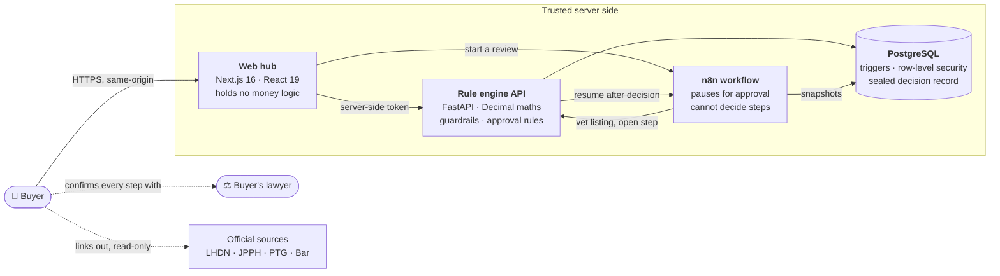
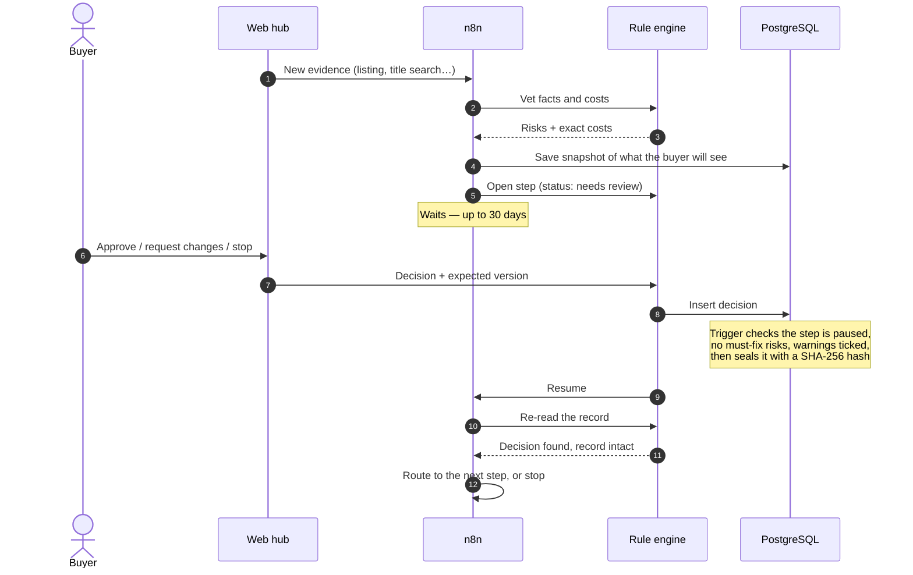
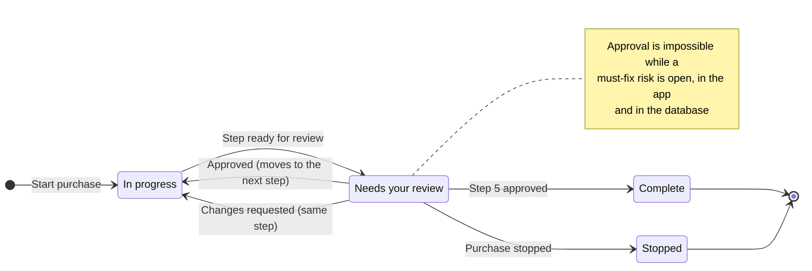

# Architecture

[← Back to README](../README.md)

## System at a glance

## One approval step, end to end

## Purchase states

## C4 detail

**Context.** A buyer works with the co-pilot alongside their own lawyer, bank and valuer. The
co-pilot only reads from official sources and links out to them. It never acts on the buyer's behalf.

**Containers.**

| Container | Responsibility | Trust |
|---|---|---|
| `web` (Next.js) | One-page hub. Server route proxies to the engine and n8n and holds their tokens. | Browser is untrusted |
| `engine` (FastAPI) | Calculator, guardrails, interpreter, HITL state machine, audit verification | Authority for money and gate rules |
| `n8n` | Orchestration: intake, snapshot, pause at Wait node, re-verify, route; daily directory freshness check | Automation role: **cannot decide gates** |
| `postgres` | System of record. Triggers re-enforce gate rules; append-only, hash-chained approvals; row-level security | Last line of defence |

**Gate cycle.** Intake webhook → engine `/v1/vet` → snapshot to `workflow_events` → engine
`/gate` (status `PAUSED_FOR_HITL`, stores `$execution.resumeUrl`) → **Wait** → the buyer decides in the
hub → the engine writes the approval (the DB computes the hash) and POSTs to the resume URL → n8n
**re-reads the audit log** and acts only if the record exists, matches, and the chain is valid → the
router sends `APPROVED` / `CHANGES_REQUESTED` / `REJECTED`. The next gate starts when new evidence
arrives through intake. A Wait timeout (30 days) stops with no side effects.

| Gate | The human approves… |
|---|---|
| `HITL_1_LISTING_VETTING` | listing and title facts, red flags, estimated upfront cash, before ordering a search |
| `HITL_2_OFFER_BUDGET` | search, site and valuation findings; offer price, cash vs. loan split, cash buffer |
| `HITL_3_LAWYER_DEPOSIT` | choice of lawyer; deposit held by the lawyer as stakeholder; written receipt requirements |
| `HITL_4_SPA_LOAN_DUTY` | SPA, loan or redemption, State consent, stamp duty, reviewed with the lawyer |
| `HITL_5_TRANSFER_HANDOVER` | MOT (Borang 14A) registered, vacant possession checklist, apportionments, then archive |

## Design principles

- **The engine is the only authority for money.** The browser never calculates; every amount travels as an exact decimal string.
- **Defence in depth.** Every approval rule is enforced twice: once in Python (`state_machine.py`) and again by PostgreSQL triggers (`db/schema.sql`). A compromised worker still can't skip a step.
- **Automation can't approve.** n8n's database role can't write decisions, and the API refuses decisions from the automation token.
- **No AI in the decision path.** Risk checks and calculations are deterministic and tested. Document reading uses bounded patterns, and its output is always shown to the buyer for checking.
